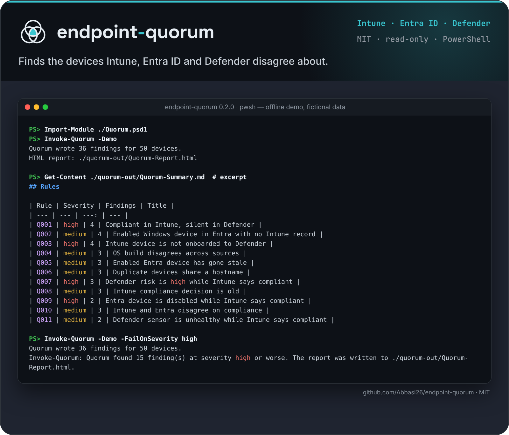

<p align="center">
  <picture>
    <source media="(prefers-color-scheme: dark)" srcset="docs/assets/logo-dark.svg">
    <source media="(prefers-color-scheme: light)" srcset="docs/assets/logo-light.svg">
    
  </picture>
</p>

<p align="center">Finds the devices Intune, Entra ID and Defender disagree about.</p>

<p align="center">
  
</p>

# Quorum

[](https://github.com/Abbasi26/endpoint-quorum/actions/workflows/ci.yml)

Quorum reads Intune, Entra ID, and Defender for Endpoint and reports the contradictions between them.

The repository is named `endpoint-quorum`; the PowerShell module is named `Quorum`. From the repository directory, import it with `Import-Module ./Quorum.psd1`.

Intune can still call a laptop compliant while Defender has not seen it for weeks. Entra can keep that laptop enabled, so a device-based access rule keeps trusting an object nobody has checked. Each console is internally consistent. The gap between them is the signal.

Example: `win11-stale-sensor` synced to Intune yesterday and is compliant. Defender last saw it 41 days ago. Entra still has the device enabled. Quorum matches the three records on the Entra device id and raises that pair of facts as a finding, with the values from each source side by side.

v0.1 is read-only. It does not compare configuration baselines, author policy as code, simulate Conditional Access, or talk to MECM. Those problems already have other tools.

## How this differs from existing tools

Microsoft365DSC, Maester, CIPP, the Intune and Entra built-in reports, and Conditional Access What-If cover configuration drift, policy tests, and Conditional Access simulation. Quorum only cross-checks device state across Intune, Entra ID, and Defender for Endpoint.

## Try it in a minute

Requires [PowerShell 7](https://learn.microsoft.com/powershell/scripting/install/installing-powershell) (Windows PowerShell 5.1 works for the same commands). From this directory:

```powershell
Import-Module ./Quorum.psd1
Invoke-Quorum -Demo
```

`-Demo` does not use the network. It evaluates the fictional inventory in `data/demo-inventory.json` (about 50 devices) and writes:

| File | What it is |
| --- | --- |
| `quorum-out/Quorum-Report.html` | One HTML file. Filter by severity, search, and open a device. No CDN. |
| `quorum-out/Quorum-Summary.md` | Short Markdown summary |
| `quorum-out/Quorum-Findings.csv` | One row per finding |
| `quorum-out/Quorum-Findings.json` | The same findings as JSON |

Open the HTML file in a browser. A full demo run should finish in well under a minute.

To share that report without real names, add `-Redact`:

```powershell
Invoke-Quorum -Demo -Redact -OutputPath .\quorum-out
```

Hostnames, display names, UPNs, and IP addresses become stable tokens for that run (`host-`..., `user-`..., `ip-`...). Quorum also writes `Quorum-RedactionMap.json`. Keep the map local. Anyone with the map can reverse the report.

## Evaluate exports you already have

No app registration yet? Export the three inventories once (Graph Explorer, an existing script, or the Defender API) and let Quorum read the files offline:

```powershell
Invoke-Quorum -IntunePath .\managedDevices.json -EntraPath .\devices.json -DefenderPath .\machines.json -Redact
```

Each file can be a plain JSON array or a raw API page with a `value` array, so you can save the response as it is. Leave a source out and the report marks it as not provided. For one combined file in the shape of `data/demo-inventory.json`, use `-InventoryPath`. `-AsOf` sets the reference time for the age facts (default: the inventory `asOf`, or now).

## Gate a scheduled run

`-FailOnSeverity` writes the report first and then throws if any finding is at that severity or worse. The result object also carries `HighestSeverity`.

```powershell
Invoke-Quorum -Demo -FailOnSeverity high      # throws: the demo has high findings
Invoke-Quorum -Demo -FailOnSeverity critical  # passes
```

## Live, read-only collection

Create one app registration. Grant only the permissions in the table below, and admin-consent them. Enable public client flows if you will use device-code sign-in. Quorum never requests a write scope, and it has no client-secret flow.

Delegated sign-in (works in PowerShell 7 on Windows, macOS, and Linux). You approve two device codes: Graph first, then Defender.

```powershell
Invoke-Quorum -TenantId 00000000-0000-0000-0000-000000000000 -ClientId 11111111-1111-1111-1111-111111111111
```

Certificate sign-in. On Windows you can pass a thumbprint from `Cert:\CurrentUser\My` or `Cert:\LocalMachine\My`. On macOS and Linux, pass a PFX.

```powershell
$secret = Read-Host -AsSecureString -Prompt 'PFX password'
Invoke-Quorum `
  -TenantId 'contoso.onmicrosoft.com' `
  -ClientId '11111111-1111-1111-1111-111111111111' `
  -CertificatePath .\quorum.pfx `
  -CertificatePassword $secret `
  -Redact `
  -OutputPath .\quorum-out
```

If one collector fails, Quorum still writes a report from the sources that succeeded and says which source failed. If every collector fails, it writes that partial report and then throws.

Optional parameters: `-RulesPath` (a directory or one YAML file), `-OutputPath`, `-GraphBaseUri`, `-DefenderBaseUri`, `-AuthorityHost`.

## Permissions

All of these are read permissions. Delegated Graph calls use Microsoft Graph. Defender calls use `https://api.security.microsoft.com`, because `Machine.Read` is narrower than a Graph hunting permission.

| Source | Request | Delegated | Application |
| --- | --- | --- | --- |
| Intune managed devices | `GET https://graph.microsoft.com/v1.0/deviceManagement/managedDevices` | `DeviceManagementManagedDevices.Read.All` | `DeviceManagementManagedDevices.Read.All` |
| Entra ID devices | `GET https://graph.microsoft.com/v1.0/devices` | `Device.Read.All` | `Device.Read.All` |
| Defender for Endpoint machines | `GET https://api.security.microsoft.com/api/machines` | `Machine.Read` on WindowsDefenderATP | `Machine.Read.All` on WindowsDefenderATP |

The token request itself asks for the two Graph delegated scopes in one device-code prompt, and `Machine.Read` in a second prompt. Application sign-in sends a certificate JWT twice: once for `https://graph.microsoft.com/.default`, once for `https://api.securitycenter.microsoft.com/.default`. Those `.default` scopes only include the application permissions you consented on the app.

## How a device is matched

1. Records that share an Entra device id (`azureADDeviceId`, `deviceId`, `aadDeviceId`) form one device. Confidence is **high** (score 0.95).
2. A record with no device id can join the one cluster that has the same hostname and does not already have that source. An exact hostname is **medium** (0.70). A short name matched to an FQDN (`lab-edge` and `lab-edge.lab.example`) is **low** (0.45).
3. Two records with different device ids are never merged, even when the hostname matches. They stay separate and are marked duplicate.
4. A device seen in only one source is **uncorroborated**.

The HTML report shows the method and confidence on each device.

## Rules

Rules are YAML files in `rules/`. Each file needs:

| Field | Required | Meaning |
| --- | --- | --- |
| `id` | yes | Short id, unique in the directory. Letters, numbers, `.`, `_`, `-`. |
| `title` | yes | One line shown in the report. |
| `severity` | yes | `critical`, `high`, `medium`, `low`, or `info`. |
| `description` | yes | What was observed. |
| `whyItMatters` | yes | Why the contradiction is a security signal. |
| `remediation` | yes | What an admin should check. Quorum does not change the device. |
| `condition` | yes | `all`, `any`, `not`, or a `fact` predicate. |
| `parameters` | no | Numbers or strings the condition can reference with `valueFrom`. |
| `groupBy` | no | A fact name. Matching devices that share it become one finding. |
| `enabled` | no | `true` by default. `false` keeps the file but skips it. |

A predicate looks like this:

```yaml
- fact: defender.lastSeenAgeDays
  op: gt
  valueFrom: defenderStaleDays
```

Operators: `eq`, `ne`, `gt`, `gte`, `lt`, `lte`, `contains`, `in`, `nin`, `exists`. `exists` takes `true` or `false`. Comparisons are case-insensitive for text. Unknown facts do not match.

Facts a rule can use:

| Fact | Meaning |
| --- | --- |
| `intune.present`, `entra.present`, `defender.present` | That source contributed a record. |
| `intune.complianceState` | Lower-case Intune compliance state, such as `compliant`. |
| `intune.lastSyncAgeDays`, `intune.osBuild` | Days since last sync, and the Windows build. |
| `entra.enabled`, `entra.isCompliant`, `entra.isManaged` | Booleans from the directory object. |
| `entra.operatingSystem`, `entra.trustType`, `entra.osBuild` | Normalized directory fields. |
| `entra.lastSignInAgeDays` | Days since `approximateLastSignInDateTime`. Missing when Entra has no timestamp. |
| `defender.healthStatus`, `defender.riskScore`, `defender.exposureLevel`, `defender.onboardingStatus` | Lower-case Defender values. |
| `defender.lastSeenAgeDays`, `defender.osBuild` | Days since `lastSeen`, and the build. |
| `os.buildMismatch`, `os.builds` | True when two sources disagree on the build number. Revisions inside one build are ignored. |
| `compliance.disagrees` | Intune and Entra compliance flags point in opposite directions. |
| `hostname.key`, `hostname.duplicate`, `hostname.duplicateCount` | Normalized name, and whether another device shares it. |
| `match.method`, `match.confidence`, `match.score` | How this device was joined. |
| `sources.count` | How many of the three sources are present. |

Ages are whole days before the collection time. In `-Demo`, that time is the `asOf` field in the inventory file.

### Starter rules

| Id | Severity | What it catches |
| --- | --- | --- |
| Q001 | high | Intune says compliant, and Defender has not reported for more than 14 days. |
| Q002 | medium | Entra device is enabled, looks like Windows, and Intune has no record. |
| Q003 | high | Intune has the device, and Defender has no record or it is not `onboarded`. |
| Q004 | medium | Two sources report different OS build numbers. |
| Q005 | medium | Entra device is still enabled and has no sign-in, or the sign-in is older than 90 days. |
| Q006 | medium | More than one device object shares a hostname. One finding per hostname. |
| Q007 | high | Defender risk is `high` while Intune says compliant. |
| Q008 | medium | Intune still says compliant, but the last sync is older than 30 days. |
| Q009 | high | Entra device is disabled while Intune says compliant. |
| Q010 | medium | Intune and Entra disagree on compliance. |
| Q011 | medium | Defender reported within 14 days with an inactive, impaired, or no-sensor health state, and Intune says compliant. |
| Q012 | high | Entra device is disabled, and Defender still has an onboarded machine that reported within 14 days. |

Thresholds live in each file under `parameters`. Change the number there; you do not have to edit the engine.

### Add a rule

Copy `rules/Q001-intune-compliant-defender-stale.yaml`, pick a free id, and keep the condition to facts in the table. Then:

```powershell
Test-QuorumRule -Path .\rules\Q013-your-rule.yaml
Invoke-Quorum -Demo -RulesPath .\rules\Q013-your-rule.yaml
Invoke-Pester ./tests
```

`Test-QuorumRule` lints rule files without touching devices: required fields, severity, duplicate ids, unknown facts (a typo would otherwise never match), unknown operators, missing values, and `valueFrom` names that are not in `parameters`. `-Quiet` returns one boolean. CI runs it on `rules/`.

See [CONTRIBUTING.md](CONTRIBUTING.md) for the test and review expectations. A rule should describe a contradiction an admin can check. It should not hide a write action or a remediation script.

## Tests

```powershell
Install-Module Pester -RequiredVersion 5.9.1 -Scope CurrentUser -Force -SkipPublisherCheck
Import-Module Pester -RequiredVersion 5.9.1
Invoke-Pester ./tests
```

The tests cover matching, the rule files, collector normalization, and redaction. They use the demo inventory and small in-memory records. They do not sign in.

GitHub Actions (`.github/workflows/ci.yml`) runs that suite on `ubuntu-latest` with PowerShell 7, and on `windows-latest` with PowerShell 7 and Windows PowerShell 5.1.

## Security and privacy

- Collection is read-only. A failed token or a missing permission stops that source; it does not fall back to a broader scope.
- Reports are files on the machine that ran `Invoke-Quorum`. Quorum does not phone home.
- `-Demo` is offline and the names in it are fictional (`lab.example`, documentation IP ranges).
- `-Redact` is for sharing. The reversal map is not.
- Do not put certificates, tokens, or a live export in this repository.

Details and how to report a vulnerability: [SECURITY.md](SECURITY.md).

## Roadmap

Detailed plan and good first issues: [ROADMAP.md](ROADMAP.md).

Not built yet. Listed so the boundary of 0.1 stays obvious.

- **0.2** — MECM as a fourth read-only source, through the AdminService.
- **0.3** — An interactive graph of the same matched devices, still from the local report.
- **0.4** — A CVE briefing built from the OS builds already collected. No new write permission.

Out of scope on purpose: configuration drift, policy-as-code, Conditional Access what-if, and turning a finding into a change in the tenant.

## Status

Version 0.2.0, early but usable. PowerShell module `Quorum` (commands `Invoke-Quorum` and `Test-QuorumRule`); the repository is named endpoint-quorum. MIT licensed. Every push runs the test suite in GitHub Actions (`.github/workflows/ci.yml`).

## Install

```sh
Import-Module ./Quorum.psd1
```

## License

[MIT](LICENSE). Copyright (c) 2026 Wasaf Abbasi.

## Kurzfassung

Quorum liest den Gerätezustand aus Intune, Entra ID und Microsoft Defender for Endpoint nur lesend ein. Es ordnet die Datensätze über die Entra-Geräte-ID einander zu, sonst über den Hostnamen, und bewertet die Sicherheit des Treffers. Widersprüche zwischen den Quellen werden als Befunde gemeldet: zum Beispiel ein Gerät, das in Intune konform ist, obwohl Defender es seit vielen Tagen nicht gesehen hat, oder ein aktiviertes Entra-Objekt ohne Intune-Eintrag.

Der Einstieg braucht kein Netzwerk: `Import-Module ./Quorum.psd1` und `Invoke-Quorum -Demo`. Dabei entsteht ein HTML-Bericht, eine Markdown-Zusammenfassung sowie CSV und JSON. Mit `-Redact` werden Hostnamen, Namen, UPNs und IP-Adressen innerhalb eines Laufs gleichbleibend pseudonymisiert. Berichte bleiben lokal. Quorum sendet keine Telemetrie und fordert keine Schreibrechte an. Nicht enthalten in 0.1: MECM, Konfigurationsdrift, Richtlinien als Code und eine Simulation des bedingten Zugriffs.
