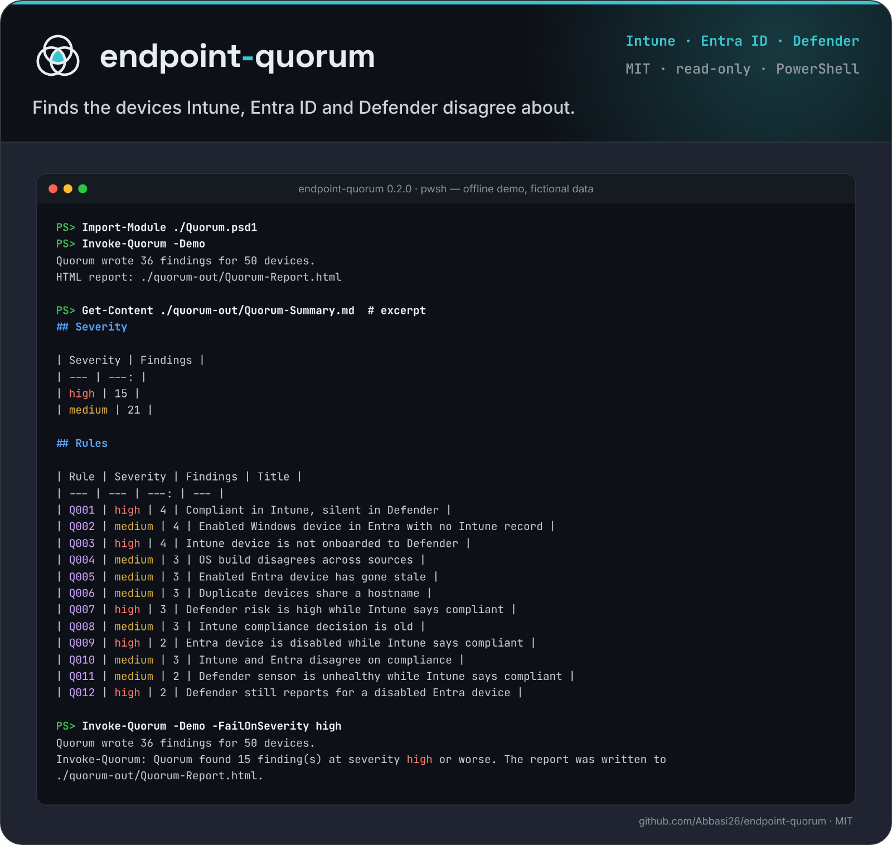
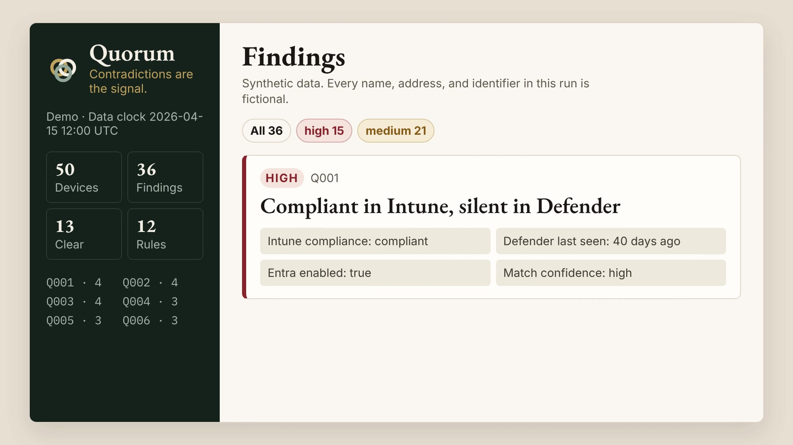

<p align="center">
  <picture>
    <source media="(prefers-color-scheme: dark)" srcset="docs/assets/logo-dark.svg">
    <source media="(prefers-color-scheme: light)" srcset="docs/assets/logo-light.svg">
    
  </picture>
</p>

<p align="center">Finds the devices Intune, Entra ID and Defender disagree about.</p>

<p align="center">
  
</p>

# Quorum

[](https://github.com/Abbasi26/endpoint-quorum/actions/workflows/ci.yml)
[](LICENSE)

Quorum reads Intune, Entra ID, and Defender for Endpoint and reports the contradictions between them.

The repository is named `endpoint-quorum`; the PowerShell module is named `Quorum`. From the repository directory, import it with `Import-Module ./Quorum.psd1`.

Intune can still call a laptop compliant while Defender has not seen it for weeks. Entra can keep that laptop enabled, so a device-based access rule keeps trusting an object nobody has checked. Each console is internally consistent. The gap between them is the signal.

Example: `win11-stale-sensor` synced to Intune yesterday and is compliant. Defender last saw it 41 days ago. Entra still has the device enabled. Quorum matches the three records on the Entra device id and raises that pair of facts as a finding, with the values from each source side by side.

v0.1 is read-only. It does not compare configuration baselines, author policy as code, simulate Conditional Access, or talk to MECM. Those problems already have other tools.

## Demo video

[](docs/media/brag.mp4)

Quorum is a read-only PowerShell module that cross-checks Intune, Entra ID and Defender for Endpoint and reports where device state disagrees. `Invoke-Quorum -Demo` runs offline on the bundled synthetic inventory and writes HTML, Markdown, CSV and JSON findings. (Click the image to play the video.)

Music: Sascha Ende ([ende.app](https://ende.app)), licensed under [CC BY 4.0](https://creativecommons.org/licenses/by/4.0/).

## How this differs from existing tools

Microsoft365DSC, Maester, CIPP, the Intune and Entra built-in reports, and Conditional Access What-If cover configuration drift, policy tests, and Conditional Access simulation. Quorum only cross-checks device state across Intune, Entra ID, and Defender for Endpoint.

## Try it in a minute

Requires [PowerShell 7.6 (LTS) or 7.7](https://learn.microsoft.com/powershell/scripting/install/installing-powershell); Windows PowerShell 5.1 works for the same commands. PowerShell 7.4 and 7.5 are out of support since 10 November 2026 and are no longer tested. From this directory:

```powershell
Import-Module ./Quorum.psd1
Invoke-Quorum -Demo
```

`-Demo` does not use the network. It evaluates the fictional inventory in `data/demo-inventory.json` (51 fictional devices) and writes:

| File | What it is |
| --- | --- |
| `quorum-out/Quorum-Report.html` | One HTML file. Filter by severity, search, and open a device. No CDN. |
| `quorum-out/Quorum-Summary.md` | Short Markdown summary |
| `quorum-out/Quorum-Findings.csv` | One row per finding |
| `quorum-out/Quorum-Findings.json` | The same findings as JSON |

Open the HTML file in a browser. A full demo run should finish in well under a minute.

To share that report without real names, add `-Redact`:

```powershell
Invoke-Quorum -Demo -Redact -OutputPath .\quorum-out
```

Hostnames, display names, UPNs, and IP addresses become stable tokens for that run (`host-`..., `user-`..., `ip-`...). Quorum also writes `Quorum-RedactionMap.json`. Keep the map local. Anyone with the map can reverse the report.

## Evaluate exports you already have

No app registration yet? Export the three inventories once (Graph Explorer, an existing script, or the Defender API) and let Quorum read the files offline:

```powershell
Invoke-Quorum -IntunePath .\managedDevices.json -EntraPath .\devices.json -DefenderPath .\machines.json -Redact
```

Each file can be a plain JSON array or a raw API page with a `value` array, so you can save the response as it is. Leave a source out and the report marks it as not provided. For one combined file in the shape of `data/demo-inventory.json`, use `-InventoryPath`. Every import path also accepts a gzip-compressed file (for example `managedDevices.json.gz`); Quorum recognises gzip by its content, not by the file name. `-AsOf` sets the reference time for the age facts (default: the inventory `asOf`, or now).

### Dynamic groups and administrative units (memberOf)

Since 3 November 2026, dynamic groups and dynamic administrative units whose rule uses the `memberOf` operator no longer update and keep their last known members ([Microsoft Learn](https://learn.microsoft.com/en-us/entra/identity/users/groups-dynamic-rule-member-of)). Rule Q013 finds them in an export:

```powershell
# Graph Explorer or any Graph client, read-only (Group.Read.All / AdministrativeUnit.Read.All):
# GET https://graph.microsoft.com/v1.0/groups?$select=id,displayName,groupTypes,membershipRule,membershipRuleProcessingState
# GET https://graph.microsoft.com/v1.0/directory/administrativeUnits?$select=id,displayName,membershipType,membershipRule,membershipRuleProcessingState
Invoke-Quorum -GroupPath .\groups.json -AdministrativeUnitPath .\administrativeUnits.json
```

Both files can be combined with the device exports, or put into an inventory file as `groups` and `administrativeUnits` arrays. The live collection does not read groups or administrative units, so it needs no extra permissions.

### Conditional Access policy plans (preview)

Policy plans group Conditional Access rules under shared conditions ([Microsoft Learn](https://learn.microsoft.com/en-us/entra/identity/conditional-access/concept-conditional-access-policy-plans)). They are a preview feature. The list API is documented in Microsoft Graph **beta** only (`GET /identity/conditionalAccess/plans`); requesting the v1.0 docs still serves the beta page, and examples use `https://graph.microsoft.com/beta/...`. Existing standalone policies keep working; plans are additive, and Quorum does not simulate sign-in or What-If.

Rules Q014 and Q015 evaluate an export. Inline each plan's `rules` (from `GET /beta/identity/conditionalAccess/plans/{id}/rules`) so Quorum can see each rule's `state` (`enabled`, `disabled`, or `enabledForReportingButNotEnforced`). A plan that only has `rules@odata.count` is counted, but Q014 does not flag it, because the rule states are unknown. Least-privileged read permission: `Policy.Read.ConditionalAccess`.

```powershell
# Graph Explorer or any Graph client, read-only, beta:
# GET https://graph.microsoft.com/beta/identity/conditionalAccess/plans
# GET https://graph.microsoft.com/beta/identity/conditionalAccess/plans/{id}/rules
Invoke-Quorum -ConditionalAccessPlanPath .\plans.json
```

### Agent ID identities and lifecycle policies

[Agent ID lifecycle policies](https://learn.microsoft.com/en-us/entra/id-governance/agent-lifecycle-policies) (preview) govern agent identities with inactivity, sponsor, and periodic reconfirmation rules. Microsoft also ships a [default inactivity policy](https://learn.microsoft.com/en-us/entra/id-governance/agent-default-inactivity-policy) to every tenant. These objects are documented in Microsoft Graph **v1.0** and beta:

- Policies: `GET /v1.0/identityGovernance/lifecycleWorkflows/lifecyclePolicies` (`LifecyclePolicies-AgentId.Read.All`). Agent policies have `@odata.type` `#microsoft.graph.identityGovernance.agentIdentityLifecyclePolicy`. Guest policies in the same list are ignored.
- Identities: `GET /v1.0/servicePrincipals/microsoft.graph.agentIdentity` (`AgentIdentity.Read.All`). Expand `sponsors`, `owners`, and `lifecycle` (and `lifecycle/effectiveGoverningPolicy` when your client can). Q017 and Q018 only use those properties when they are present in the export.

```powershell
# Graph Explorer or any Graph client, read-only, v1.0:
# GET https://graph.microsoft.com/v1.0/identityGovernance/lifecycleWorkflows/lifecyclePolicies
# GET https://graph.microsoft.com/v1.0/servicePrincipals/microsoft.graph.agentIdentity?$expand=sponsors,owners,lifecycle
Invoke-Quorum -LifecyclePolicyPath .\lifecyclePolicies.json -AgentIdentityPath .\agentIdentities.json
```

These arrays can also live in an inventory file as `conditionalAccessPlans`, `lifecyclePolicies`, and `agentIdentities`. The live collection does not read them, so it still requests only the device permissions in the table below.

## Gate a scheduled run

`-FailOnSeverity` writes the report first and then throws if any finding is at that severity or worse. The result object also carries `HighestSeverity`.

`-FailOnCount` fails the run when the finding count reaches this threshold. With `-FailOnSeverity` it counts only findings at that severity or worse; alone it counts all findings.

```powershell
Invoke-Quorum -Demo -FailOnSeverity high       # throws: the demo has 20 high findings
Invoke-Quorum -Demo -FailOnSeverity critical   # passes
Invoke-Quorum -Demo -FailOnCount 44            # throws: demo has 44 total findings
Invoke-Quorum -Demo -FailOnCount 45            # passes
Invoke-Quorum -Demo -FailOnSeverity high -FailOnCount 10  # throws: 20 high >= 10
Invoke-Quorum -Demo -FailOnSeverity high -FailOnCount 25  # passes
```

## Live, read-only collection

Create one app registration. Grant only the permissions in the table below, and admin-consent them. Enable public client flows if you will use device-code sign-in. Quorum never requests a write scope, and it has no client-secret flow.

Delegated sign-in (works in PowerShell 7 on Windows, macOS, and Linux). You approve two device codes: Graph first, then Defender.

```powershell
Invoke-Quorum -TenantId 00000000-0000-0000-0000-000000000000 -ClientId 11111111-1111-1111-1111-111111111111
```

Certificate sign-in. On Windows you can pass a thumbprint from `Cert:\CurrentUser\My` or `Cert:\LocalMachine\My`. On macOS and Linux, pass a PFX.

```powershell
$secret = Read-Host -AsSecureString -Prompt 'PFX password'
Invoke-Quorum `
  -TenantId 'contoso.onmicrosoft.com' `
  -ClientId '11111111-1111-1111-1111-111111111111' `
  -CertificatePath .\quorum.pfx `
  -CertificatePassword $secret `
  -Redact `
  -OutputPath .\quorum-out
```

If one collector fails, Quorum still writes a report from the sources that succeeded and says which source failed. If every collector fails, it writes that partial report and then throws.

Optional parameters: `-RulesPath` (a directory or one YAML file), `-OutputPath`, `-GraphBaseUri`, `-DefenderBaseUri`, `-AuthorityHost`.

## Permissions

All of these are read permissions. Delegated Graph calls use Microsoft Graph. Defender calls use `https://api.security.microsoft.com`, because `Machine.Read` is narrower than a Graph hunting permission.

| Source | Request | Delegated | Application |
| --- | --- | --- | --- |
| Intune managed devices | `GET https://graph.microsoft.com/v1.0/deviceManagement/managedDevices` | `DeviceManagementManagedDevices.Read.All` | `DeviceManagementManagedDevices.Read.All` |
| Entra ID devices | `GET https://graph.microsoft.com/v1.0/devices` | `Device.Read.All` | `Device.Read.All` |
| Defender for Endpoint machines | `GET https://api.security.microsoft.com/api/machines` | `Machine.Read` on WindowsDefenderATP | `Machine.Read.All` on WindowsDefenderATP |

The token request itself asks for the two Graph delegated scopes in one device-code prompt, and `Machine.Read` in a second prompt. Application sign-in sends a certificate JWT twice: once for `https://graph.microsoft.com/.default`, once for `https://api.securitycenter.microsoft.com/.default`. Those `.default` scopes only include the application permissions you consented on the app.

## How a device is matched

1. Records that share an Entra device id (`azureADDeviceId`, `deviceId`, `aadDeviceId`) form one device. Confidence is **high** (score 0.95).
2. A record with no device id can join the one cluster that has the same hostname and does not already have that source. An exact hostname is **medium** (0.70). A short name matched to an FQDN (`lab-edge` and `lab-edge.lab.example`) is **low** (0.45).
3. Two records with different device ids are never merged, even when the hostname matches. They stay separate and are marked duplicate.
4. A device seen in only one source is **uncorroborated**.

The HTML report shows the method and confidence on each device.

## Windows Server as a device class

Enrolled Windows Server devices appear under the Windows platform in Intune, alongside PCs. Quorum therefore does not treat Intune `operatingSystem` `Windows` as proof that a device is a client. It assigns `device.class` `windows-server` when any of these documented signals is present:

- Intune `skuNumber` 7, 8, 79, 80, or 407, or the assignment-filter names `ServerStandard`, `ServerDatacenter`, `ServerStandardEval`, `ServerDatacenterEval`, or `ServerTurbine` ([filter properties](https://learn.microsoft.com/en-us/intune/fundamentals/filters/ref-device-properties), [preview guide](https://learn.microsoft.com/en-us/intune/solutions/end-to-end-guides/windows-server-endpoints-get-started)). `ServerRdsh` (175) is Windows 10/11 Enterprise multi-session and stays `windows`.
- Entra `operatingSystem` equal to `Windows Server` ([Entra PowerShell](https://learn.microsoft.com/en-us/powershell/entra-powershell/manage-devices?view=entra-powershell)).
- Defender `osPlatform` equal to `Windows Server`, or a compact value that starts with `WindowsServer` ([OS platform change](https://techcommunity.microsoft.com/blog/intunecustomersuccess/windows-server-devices-managed-by-defender-for-endpoint-now-recognized-as-a-new-/3767773)). The Defender machine resource does not publish a full `osPlatform` enumeration.

Microsoft Intune can manage eligible Windows Server devices only as an Insider preview, for nonproduction testing, and only for Windows Server vNext builds 29621.1000 or later with Desktop Experience. Server enrollment is blocked by default. See [What's new in Microsoft Intune](https://learn.microsoft.com/en-us/intune/whats-new/) (week of 16 November 2026, service release 2611) and the [end-to-end preview guide](https://learn.microsoft.com/en-us/intune/solutions/end-to-end-guides/windows-server-endpoints-get-started). Graph `skuNumber` and `skuFamily` are documented on [managedDevice in Graph beta](https://learn.microsoft.com/en-us/graph/api/resources/intune-devices-manageddevice?view=graph-rest-beta); they are not listed on the v1.0 page. The live collector stays on v1.0 by default and reads those properties when the payload includes them (a beta export, or `-GraphBaseUri https://graph.microsoft.com/beta`). If Intune only reports `operatingSystem` `Windows` and no server SKU, the class stays `windows`.

The demo inventory includes `winsrv-pilot-01`, an enrolled preview server, and `entra-only-04`, a released Windows Server 2022 object that has no Intune record.

## Rules

Rules are YAML files in `rules/`. Each file needs:

| Field | Required | Meaning |
| --- | --- | --- |
| `id` | yes | Short id, unique in the directory. Letters, numbers, `.`, `_`, `-`. |
| `title` | yes | One line shown in the report. |
| `severity` | yes | `critical`, `high`, `medium`, `low`, or `info`. |
| `description` | yes | What was observed. |
| `whyItMatters` | yes | Why the contradiction is a security signal. |
| `remediation` | yes | What an admin should check. Quorum does not change the device. |
| `condition` | yes | `all`, `any`, `not`, or a `fact` predicate. |
| `parameters` | no | Numbers or strings the condition can reference with `valueFrom`. |
| `groupBy` | no | A fact name. Matching devices that share it become one finding. |
| `subject` | no | `device` (default), `directoryObject`, `conditionalAccessPlan`, `lifecyclePolicy`, `lifecyclePolicySet`, or `agentIdentity`. Non-device subjects evaluate the matching export; they never join device matching. |
| `enabled` | no | `true` by default. `false` keeps the file but skips it. |

A predicate looks like this:

```yaml
- fact: defender.lastSeenAgeDays
  op: gt
  valueFrom: defenderStaleDays
```

Operators: `eq`, `ne`, `gt`, `gte`, `lt`, `lte`, `contains`, `in`, `nin`, `exists`. `exists` takes `true` or `false`. Comparisons are case-insensitive for text. Unknown facts do not match.

Facts a rule can use:

| Fact | Meaning |
| --- | --- |
| `intune.present`, `entra.present`, `defender.present` | That source contributed a record. |
| `intune.complianceState` | Lower-case Intune compliance state, such as `compliant`. |
| `intune.lastSyncAgeDays`, `intune.osBuild` | Days since last sync, and the Windows build. |
| `entra.enabled`, `entra.isCompliant`, `entra.isManaged` | Booleans from the directory object. |
| `entra.operatingSystem`, `entra.trustType`, `entra.osBuild` | Normalized directory fields. |
| `device.class` | Device class from all sources: `windows`, `windows-server`, `macos`, `ios`, `android`, `linux`, or `unknown`. |
| `entra.lastSignInAgeDays` | Days since `approximateLastSignInDateTime`. Missing when Entra has no timestamp. |
| `defender.healthStatus`, `defender.riskScore`, `defender.exposureLevel`, `defender.onboardingStatus` | Lower-case Defender values. |
| `defender.lastSeenAgeDays`, `defender.osBuild` | Days since `lastSeen`, and the build. |
| `os.buildMismatch`, `os.builds` | True when two sources disagree on the build number. Revisions inside one build are ignored. |
| `compliance.disagrees` | Intune and Entra compliance flags point in opposite directions. |
| `hostname.key`, `hostname.duplicate`, `hostname.duplicateCount` | Normalized name, and whether another device shares it. |
| `match.method`, `match.confidence`, `match.score` | How this device was joined. |
| `sources.count` | How many of the three sources are present. |

Facts for `subject: directoryObject` rules:

| Fact | Meaning |
| --- | --- |
| `directory.kind` | `group` or `administrativeUnit`. |
| `directory.displayName`, `directory.membershipRule` | Name and membership rule as exported. |
| `directory.dynamic` | Group with `DynamicMembership` in `groupTypes`, or AU with `membershipType` `Dynamic`. |
| `directory.processingState` | Lower-case `membershipRuleProcessingState`, such as `on` or `paused`. |
| `directory.usesMemberOf` | Dynamic, and the rule uses `user.memberof` or `device.memberof`. |

Facts for `subject: conditionalAccessPlan` rules (from a plans export):

| Fact | Meaning |
| --- | --- |
| `plan.displayName`, `plan.description`, `plan.version`, `plan.templateId` | Plan metadata as exported. |
| `plan.ownerCount`, `plan.hasOwners` | Owners are a string collection of user or group ids. Null when `owners` was not exported. |
| `plan.ruleCount` | Length of the inlined `rules` array, or `rules@odata.count` when rules were not expanded. |
| `plan.enforcingRuleCount`, `plan.reportOnlyRuleCount`, `plan.disabledRuleCount` | Counts by rule `state`. Null when rules were not inlined. |
| `plan.hasEnforcingRule` | True when at least one inlined rule has `state` `enabled`. False when rules are inlined and none are enabled, or when `ruleCount` is 0. Null when only `rules@odata.count` is present and is greater than 0. |
| `plan.hasSharedConditions` | The plan has a non-empty `sharedConditions` object. |
| `plan.rulesExpanded` | The `rules` array was present on the plan. |
| `plan.tagCount` | Number of tags, when `tags` was exported. |

Facts for `subject: lifecyclePolicy` and `subject: lifecyclePolicySet` rules (from a lifecycle policies export):

| Fact | Meaning |
| --- | --- |
| `lifecyclePolicy.isAgentIdentity` | `@odata.type` contains `agentIdentityLifecyclePolicy`. Guest policies are false. |
| `lifecyclePolicy.isEnabled`, `lifecyclePolicy.isSystemDefault`, `lifecyclePolicy.policySource` | Policy flags. `systemDefault` is the Microsoft-managed default. |
| `lifecyclePolicy.enforcementKind` | `disable`, `delete`, or `disableThenDelete`, from the enforcement action `@odata.type`. |
| `lifecyclePolicy.ruleCount`, `lifecyclePolicy.enabledRuleCount`, `lifecyclePolicy.gracePeriodInDays`, `lifecyclePolicy.versionNumber`, `lifecyclePolicy.displayName` | Policy fields as exported. |
| `lifecyclePolicySet.agentPolicyCount`, `lifecyclePolicySet.enabledAgentPolicyCount` | Counts of agent (not guest) policies in the export. |
| `lifecyclePolicySet.defaultPresent`, `lifecyclePolicySet.defaultEnabled` | Whether a `systemDefault` agent policy is in the export, and whether it is enabled. |

Facts for `subject: agentIdentity` rules (from an agent identity export):

| Fact | Meaning |
| --- | --- |
| `agent.displayName`, `agent.accountEnabled`, `agent.blueprintId`, `agent.disabledByMicrosoft` | Identity fields as exported. |
| `agent.sponsorCount`, `agent.hasSponsors`, `agent.ownerCount`, `agent.hasOwners` | Null when that collection was not exported. An empty array counts as zero. |
| `agent.lifecyclePresent` | A `lifecycle` object was present. |
| `agent.hasEffectiveGoverningPolicy` | `lifecycle.effectiveGoverningPolicy` was present and non-null. Null when `lifecycle` is missing or the navigation was not expanded. |
| `agent.complianceIssueCount`, `agent.lastAttestationAgeDays` | From `lifecycle`, when those properties were exported. |

Ages are whole days before the collection time. In `-Demo`, that time is the `asOf` field in the inventory file.

### Starter rules

| Id | Severity | What it catches |
| --- | --- | --- |
| Q001 | high | Intune says compliant, and Defender has not reported for more than 14 days. |
| Q002 | medium | Entra device is enabled, is a Windows client, and Intune has no record. Windows Server is a separate class and does not match. |
| Q003 | high | Intune has the device, and Defender has no record or it is not `onboarded`. |
| Q004 | medium | Two sources report different OS build numbers. |
| Q005 | medium | Entra device is still enabled and has no sign-in, or the sign-in is older than 90 days. |
| Q006 | medium | More than one device object shares a hostname. One finding per hostname. |
| Q007 | high | Defender risk is `high` while Intune says compliant. |
| Q008 | medium | Intune still says compliant, but the last sync is older than 30 days. |
| Q009 | high | Entra device is disabled while Intune says compliant. |
| Q010 | medium | Intune and Entra disagree on compliance. |
| Q011 | medium | Defender reported within 14 days with an inactive, impaired, or no-sensor health state, and Intune says compliant. |
| Q012 | high | Entra device is disabled, and Defender still has an onboarded machine that reported within 14 days. |
| Q013 | high | A dynamic group or dynamic administrative unit uses the `memberOf` operator, which stopped updating on 3 November 2026. Needs a groups or AU export. |
| Q014 | medium | A Conditional Access policy plan has no rule in the `enabled` state (all missing, disabled, or report-only). Needs a plans export with inlined rules. Graph beta; preview. |
| Q015 | low | A Conditional Access policy plan has no owners. Owners are metadata only. Needs a plans export. Graph beta; preview. |
| Q016 | high | The lifecycle policies export has no enabled Agent ID lifecycle policy (guest policies are ignored). Graph v1.0. |
| Q017 | high | An enabled agent identity has a `lifecycle` object, and `effectiveGoverningPolicy` is null. Needs an agent identity export with lifecycle expanded. Graph v1.0. |
| Q018 | medium | An enabled agent identity has an empty `sponsors` collection. Needs an agent identity export with sponsors expanded. Graph v1.0. |

Thresholds live in each file under `parameters`. Change the number there; you do not have to edit the engine.

### Add a rule

Copy `rules/Q001-intune-compliant-defender-stale.yaml`, pick a free id, and keep the condition to facts in the table. Then:

```powershell
Test-QuorumRule -Path .\rules\Q019-your-rule.yaml
Invoke-Quorum -Demo -RulesPath .\rules\Q019-your-rule.yaml
Invoke-Pester ./tests
```

`Test-QuorumRule` lints rule files without touching devices: required fields, severity, duplicate ids, unknown facts (a typo would otherwise never match), unknown operators, missing values, and `valueFrom` names that are not in `parameters`. It also rejects a `remediation` that is a one-word placeholder, because an admin should be able to act on it from the report. `-Quiet` returns one boolean. CI runs it on `rules/`.

See [CONTRIBUTING.md](CONTRIBUTING.md) for the test and review expectations. A rule should describe a contradiction an admin can check. It should not hide a write action or a remediation script.

## Tests

```powershell
Install-Module Pester -RequiredVersion 5.9.1 -Scope CurrentUser -Force -SkipPublisherCheck
Import-Module Pester -RequiredVersion 5.9.1
Invoke-Pester ./tests
```

The suite has 83 Pester tests. They cover matching, the rule files, collector normalization, device classification, and redaction. They use the demo inventory and small in-memory records. They do not sign in.

GitHub Actions (`.github/workflows/ci.yml`) runs that suite on `ubuntu-latest` with PowerShell 7.6 LTS and 7.7, and on `windows-latest` with PowerShell 7.6 LTS, 7.7, and Windows PowerShell 5.1.

## Security and privacy

- Collection is read-only. A failed token or a missing permission stops that source; it does not fall back to a broader scope.
- Reports are files on the machine that ran `Invoke-Quorum`. Quorum does not phone home.
- `-Demo` is offline and the names in it are fictional (`lab.example`, documentation IP ranges).
- `-Redact` is for sharing. The reversal map is not.
- Do not put certificates, tokens, or a live export in this repository.

Details and how to report a vulnerability: [SECURITY.md](SECURITY.md).

## Roadmap

Detailed plan and good first issues: [ROADMAP.md](ROADMAP.md).

Not built yet. Listed so the boundary of 0.1 stays obvious.

- **0.2** — MECM as a fourth read-only source, through the AdminService.
- **0.3** — An interactive graph of the same matched devices, still from the local report.
- **0.4** — A CVE briefing built from the OS builds already collected. No new write permission.

Out of scope on purpose: configuration drift, policy-as-code, Conditional Access what-if, and turning a finding into a change in the tenant.

## Status

Version 0.2.0, early but usable. PowerShell module `Quorum` (commands `Invoke-Quorum` and `Test-QuorumRule`); the repository is named endpoint-quorum. MIT licensed. Every push runs the test suite in GitHub Actions (`.github/workflows/ci.yml`).

## Install

```sh
Import-Module ./Quorum.psd1
```

## License

[MIT](LICENSE). Copyright (c) 2026 Wasaf Abbasi.

## Kurzfassung

Quorum liest den Gerätezustand aus Intune, Entra ID und Microsoft Defender for Endpoint nur lesend ein. Es ordnet die Datensätze über die Entra-Geräte-ID einander zu, sonst über den Hostnamen, und bewertet die Sicherheit des Treffers. Widersprüche zwischen den Quellen werden als Befunde gemeldet: zum Beispiel ein Gerät, das in Intune konform ist, obwohl Defender es seit vielen Tagen nicht gesehen hat, oder ein aktiviertes Entra-Objekt ohne Intune-Eintrag.

Der Einstieg braucht kein Netzwerk: `Import-Module ./Quorum.psd1` und `Invoke-Quorum -Demo`. Dabei entsteht ein HTML-Bericht, eine Markdown-Zusammenfassung sowie CSV und JSON. Mit `-Redact` werden Hostnamen, Namen, UPNs und IP-Adressen innerhalb eines Laufs gleichbleibend pseudonymisiert. Berichte bleiben lokal. Quorum sendet keine Telemetrie und fordert keine Schreibrechte an. Zusätzlich zu den Geräteregeln werten Q013 bis Q018 optionale Exporte aus: dynamische Gruppen und administrative Einheiten, Conditional-Access-Policy-Plans (Vorschau, Microsoft Graph beta) sowie Agent-ID-Identitäten und deren Lifecycle-Richtlinien (Microsoft Graph v1.0). Die Live-Sammlung liest diese Objekte nicht. Nicht enthalten: MECM, Konfigurationsdrift, Richtlinien als Code und eine Simulation des bedingten Zugriffs.
