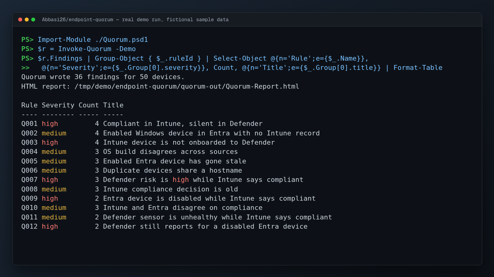

# Demo screenshot



`demo.png` (1600x900) is the unedited terminal output of a real demo run, rendered to an image on 2026-11-03. All hosts, users, devices and files in it are fictional sample data that ships with this repository. No network service or real system was involved.

Setup: PowerShell 7, from the repository root.

Commands, in the order shown in the image:

```text
PS> Import-Module ./Quorum.psd1
PS> $r = Invoke-Quorum -Demo
PS> $r.Findings | Group-Object { $_.ruleId } | Select-Object @{n='Rule';e={$_.Name}},
>>   @{n='Severity';e={$_.Group[0].severity}}, Count, @{n='Title';e={$_.Group[0].title}} | Format-Table
```

Pipes such as `head`, `grep` or `sed` in the commands above only shorten the output so it fits on one screen. They are part of the shown command.
